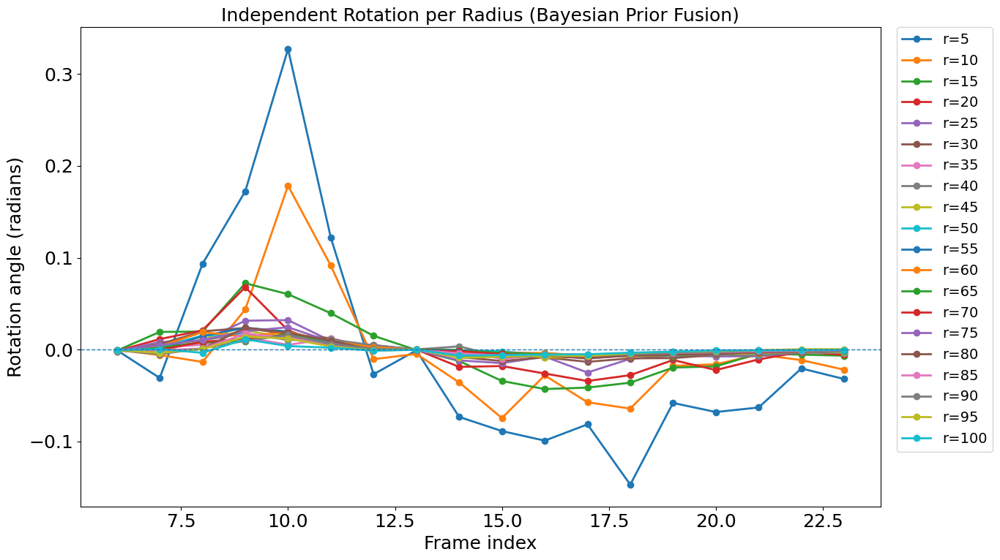
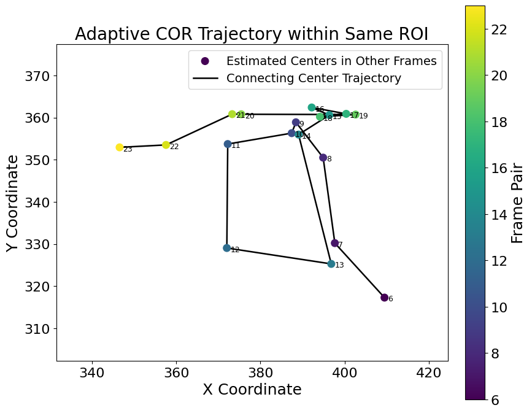

# BBVI Rotation Estimation of Fasciculations in ALS Muscle Ultrasound

Code for the ultrasound experiments in

> T. Shahzadi, J. Zhou, K. Bokuda, N. Tagawa.
> **Fasciculation Detection in Ultrasound Images for ALS Diagnosis Based on Black Box Variational Inference.**
> *Proc. 21st Int. Conf. on Computer Vision Theory and Applications (VISAPP 2026)*, vol. 3, pp. 688–695.
> doi:[10.5220/0014623000004084](https://doi.org/10.5220/0014623000004084)

A fasciculation shows up in a cross-sectional muscle ultrasound as a brief rotation of a fibre bundle.
This repository estimates that rotation, ring by ring around a rotation centre, between video frames using
black-box variational inference (reparameterisation trick) inside a variational EM loop over a three-level
image pyramid. The rotation centre and the photometric noise level are estimated in the M-step.

<p align="center">
  
  
</p>

---

## Repository layout

| Script | Used for | Posterior | Notes |
|---|---|---|---|
| `src/fasciculation_detection_bbvi.py` | VISAPP 2026 Figs. 3(b), 5, 6 | unstructured, 20 rings of 5 px | CLI options listed below |
| `src/bbvi_radial_bins_legendre.py` | VISAPP 2026 Fig. 4(b) | Legendre basis (K = 5) with KL to N(0, 1) | non-uniform radial bins, see below |
| `src/bbvi_ultrasound_structured.py` | journal extension, real-data 2 × 2 | unstructured or cosine basis in r (U = 6), step 1 or 3 | unsupervised metrics: MSE, radial roughness, stability |
| `src/runconfig.py` | helper | | `--NAME VALUE` overrides, figure saving |

`data/Original_Groundtruth_Values.csv` holds the optical-flow values used to initialise the first frame pair
(row "Frame 6"). Despite the file name these are not ground truth; their magnitude is about 10⁻³, so the
estimators effectively start from zero rotation.

## Quick start

```bash
git clone https://github.com/ShzdiTrnum/ALS-Fasciculation-BBVI-Detection-Ultrasound.git
cd ALS-Fasciculation-BBVI-Detection-Ultrasound
python -m venv .venv && source .venv/bin/activate      # Windows: .venv\Scripts\activate
pip install -r requirements.txt                       # install the CUDA build of PyTorch for GPU

# put the two input files in data/ (see data/README.md), then
python src/fasciculation_detection_bbvi.py
```

Every figure and the numbers behind it are written to `outputs/` (see [Outputs](#outputs)).
Add `--show` to also open the figures in a window.

## Configuration

The defaults in the script are the settings used for the experiments. Each can be changed from the
command line (`python src/fasciculation_detection_bbvi.py --help`):

| Option | Default | Meaning |
|---|---|---|
| `--video` | `data/ALS - Trim20s.mp4` | input video |
| `--init-csv` | `data/Original_Groundtruth_Values.csv` | initial per-ring angles (first data row is used) |
| `--frame-start`, `--frame-end` | 6, 24 | 1-based, inclusive |
| `--frame-step` | 1 | pair frame *i* with frame *i + step* |
| `--roi XMIN XMAX YMIN YMAX` | 250 500 200 450 | ROI in image pixels (250 × 250) |
| `--radii START STOP STEP` | 5 101 5 | ring radii `np.arange(5, 101, 5)` → 20 rings |
| `--mc-samples` | 30 | Monte-Carlo samples *S* |
| `--outer-em` | 60 | outer EM iterations per pyramid level |
| `--e-updates`, `--m-updates` | 30, 10 | inner E- and M-step Adam steps |
| `--e-lr`, `--m-lr` | 1e-4 ×3, 1e-4 ×3 | Adam learning rates per level |
| `--seed` | none | fix the random seed; the original runs did not fix one, so reruns differ slightly |
| `--output-dir` | `outputs` | where results are written |

Pyramid scales are fixed at `[0.25, 0.5, 1.0]`. A GPU is strongly recommended.

## Pipeline

```
Fasciculation-Simulation ──► synthetic video + ground truth ──► ALS-Fasciculation-BBVI-Detection-Synthetic-Data
Optical-Flow (Green's-theorem baseline) ──► initial angles CSV ──► this repository (real ALS ultrasound)
```

* [Optical-Flow](https://github.com/ShzdiTrnum/Optical-Flow): optical-flow / Green's-theorem baseline (Fig. 3a, 4a of the paper)
* [ALS-Fasciculation-BBVI-Detection-Synthetic-Data](https://github.com/ShzdiTrnum/ALS-Fasciculation-BBVI-Detection-Synthetic-Data): the same estimator on synthetic video with known ground truth
* [Fasciculation-Simulation](https://github.com/ShzdiTrnum/Fasciculation-Simulation): synthetic rotating-ring videos

## Paper figures → files

| Paper (VISAPP 2026) | Produced by | Output file |
|---|---|---|
| Fig. 3(b) BBVI rotation per radius | `fasciculation_detection_bbvi.py` | `rotation_per_radius.png`, `rotation_mu.csv` |
| Fig. 3(a) / 4(a) optical flow | `Optical-Flow` repo | — |
| Fig. 4(b) BBVI with non-uniform radial bins | `bbvi_radial_bins_legendre.py` | `bbvi_radial_bins_legendre_figNN.png` |
| Fig. 5 centre-of-rotation trajectory | `fasciculation_detection_bbvi.py` | `center_trajectory_image_coords.png`, `center_trajectory.csv` |
| Fig. 6 MSE / ELBO / noise variance | `fasciculation_detection_bbvi.py` | `convergence_*.png` |

## Journal extension: structured vs unstructured, step 1 vs 3

```bash
python src/bbvi_ultrasound_structured.py --STRUCTURED False --FRAME_STEP 1
python src/bbvi_ultrasound_structured.py --STRUCTURED True  --FRAME_STEP 1
python src/bbvi_ultrasound_structured.py --STRUCTURED False --FRAME_STEP 3
python src/bbvi_ultrasound_structured.py --STRUCTURED True  --FRAME_STEP 3
```

Settings: S = 20, 50 outer EM iterations, 30 E-steps, 50 M-steps, learning rates 1e-4, `U_BASIS = 6`.
Each run appends one row (mean MSE, radial roughness, frame-to-frame stability) to
`outputs/real_results.csv` and saves per-pair arrays to `outputs/real_perpair_runs/`.
There is no ground truth for real data, so these runs show smoothness and stability, not accuracy.
`python src/bbvi_ultrasound_structured.py --help-config` lists all settings.

## Radial bins used for Fig. 4(b)

`bbvi_radial_bins_legendre.py` sets `radii = [19, 17, 15, 13, 11, 9, 7, 5, 4]` and builds each mask as
`(r − radii[0], r] = (r − 19, r]`. Because the masks are written in that order, smaller radii overwrite larger
ones, and the effective bins are 0–4, 4–5, 5–7, 7–9, …, 17–19 px. Pixels farther than 19 px from the ROI
centre are warped with θ = 0. The initial angles are the first nine optical-flow columns.

## Outputs

| File | Content |
|---|---|
| `run_config.json` | every setting used for the run, device and PyTorch version |
| `bbvi_results.npz` | all arrays below in one file |
| `rotation_mu.csv` | posterior mean angle (rad) per ring and frame pair |
| `rotation_posterior_variance.csv` | posterior variance per ring and frame pair |
| `center_trajectory.csv` | estimated centre per pair, ROI and image coordinates |
| `rotation_per_radius.png/pdf` | rotation per ring vs. frame |
| `posterior_variance.png/pdf` | variance per ring vs. frame |
| `convergence_mse / _noise_variance / _elbo .png/pdf` | per-level convergence (last frame pair) |
| `center_trajectory_roi / _image_coords .png/pdf` | centre trajectory |

## How the code relates to the paper's equations

`fasciculation_detection_bbvi.py` implements the unstructured (independent per-ring) posterior. Compared with the full formulation
in the paper, the released version omits the KL term in the E-step, uses the product-of-Gaussians fusion to
initialise each level rather than as a prior inside the objective, and keeps the ring masks centred on the ROI.
The convergence plot labelled "ELBO" therefore shows the expected log-likelihood term.
[`docs/algorithm_overview.md`](docs/algorithm_overview.md) lists these points in detail.

## Data

The clinical ultrasound videos were acquired at Tokyo Metropolitan Neurological Hospital and are not
redistributed here. See [`data/README.md`](data/README.md) for the expected file formats.

## Citation

```bibtex
@inproceedings{shahzadi2026bbvi,
  author    = {Shahzadi, Turrnum and Zhou, Junfeng and Bokuda, Kota and Tagawa, Norio},
  title     = {Fasciculation Detection in Ultrasound Images for {ALS} Diagnosis Based on Black Box Variational Inference},
  booktitle = {Proceedings of the 21st International Conference on Computer Vision Theory and Applications (VISAPP)},
  volume    = {3},
  pages     = {688--695},
  year      = {2026},
  publisher = {SciTePress},
  doi       = {10.5220/0014623000004084}
}
```

## Acknowledgements

Supported by AMED under Grant Number JP25ym0126818.

## License

MIT (see `LICENSE`).
